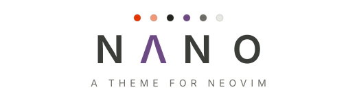
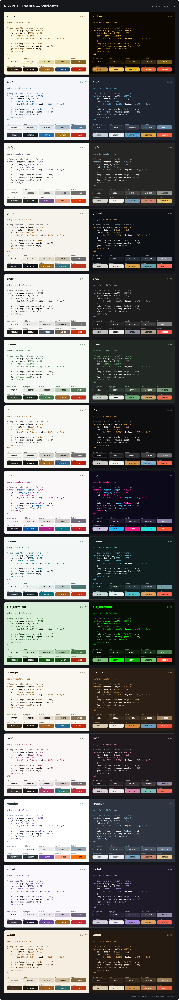

<p align="center">
  <picture>
    <source media="(prefers-color-scheme: dark)" srcset="./screenshots/logo-dark.svg">
    
  </picture>
</p>

<p align="center">
  A Neovim port of @rougier's excellent
  <a href="https://github.com/rougier/nano-theme">N Λ N O Theme</a> for Emacs:
  six semantic faces, 15 curated variants, and independent light and dark modes.
</p>

<p align="center">
  
  
  
</p>

## Philosophy

Instead of a large syntax rainbow, N Λ N O builds every screen from six semantic faces:

| Face | Purpose |
|:--|:--|
| **Critical** | Information that requires immediate action — high contrast, used scarcely. |
| **Popout** | Information that needs attention, attracted by a clearly different hue. |
| **Strong** | Structural information such as titles and keywords — the default color with a heavier weight. |
| **Salient** | Important information — a different hue with roughly the same intensity as the default face. |
| **Faded** | Less important information such as comments — the default hue family at a lower intensity. |
| **Subtle** | Physical delimitation of screen areas through barely perceptible backgrounds. |

Compared to the Emacs original, the light background is warmer, the dark background omits
the blue tint, and the colors are tuned to meet minimum accessibility contrast
requirements.

## Features

- 15 variants, with the light and dark palettes selected independently.
- Live variant selector built on `vim.ui.select`, with previews when the selector UI
  supports them.
- Transparent backgrounds that retain contrast for selections, searches, diagnostics, and
  diffs, with optional blended float backgrounds.
- Modern treesitter captures (Neovim 0.10+, with the legacy names kept for older
  versions), LSP semantic tokens, colored diagnostic undercurls, and inlay hints.
- Terminal colors, a lualine theme that follows runtime variant switches, and integrations
  for bufferline, copilot, dashboard, fzf-lua, indent-blankline, mini.nvim, neogit,
  neo-tree, noice, notify, telescope, tiny-cmdline, and treesitter.
- A dependency-free headless test suite.

## Installation

The suggested installation method is using `vim.pack.add` in Neovim v0.12+:

```lua
vim.pack.add({ "ronisbr/nano-theme.nvim" })
vim.o.background = "light" -- or "dark".
vim.cmd.colorscheme("nano-theme")
```

With MiniDeps:

```lua
MiniDeps.add({ source = "ronisbr/nano-theme.nvim" })
vim.o.background = "light" -- or "dark".
vim.cmd.colorscheme("nano-theme")
```

## Configuration

Call `setup` before activating the colorscheme to change the defaults:

```lua
require("nano-theme").setup({
  light_variant      = "default",
  dark_variant       = "default",
  transparent        = false,
  transparent_floats = true,
  float_blend        = 0,
})
vim.cmd.colorscheme("nano-theme")
```

| Option | Default | Description |
|:--|:--|:--|
| `light_variant` | `"default"` | Variant applied when `background` is `light`. |
| `dark_variant` | `"default"` | Variant applied when `background` is `dark`. |
| `transparent` | `false` | Clear background-bearing editor and integration surfaces. |
| `transparent_floats` | `true` | When transparency is on, make `NormalFloat`, `FloatBorder`, and `FloatTitle` fully transparent instead of retaining Nano's float background. |
| `float_blend` | `0` | Integer from 0 through 100 applied to Nano float highlight groups when their background is retained. It does not mutate Neovim's `winblend` option. |

`setup` validates the variant names and the float options. See `:h nano-theme` for the
full documentation.

## Variants



| Variant | Description |
|:--|:--|
| `amber` | Amber phosphor CRT monitor palette. Dark mode uses a near-black background with warm golden-amber glowing text; light mode uses a warm parchment background with deep amber ink. |
| `blue` | Cool, steel-blue tinted palette where backgrounds and accents lean toward blue tones. |
| `default` | Warm, slightly tinted palette faithful to the original N Λ N O Emacs theme. |
| `gilded` | Ink, paper, and gold palette — a sibling of `ink` with a softer, warmer character. Dark mode uses a blue-tinted ink background with warm paper text, a gilded gold salient, and a muted teal popout; light mode uses a warm paper background with dark ink text. Choose `ink` for maximum neutral contrast, `gilded` for the tinted, paper-like rendition of the same gold/cool-accent scheme. |
| `gray` | Fully desaturated, neutral gray palette. Salient and popout faces use achromatic tones for a monochrome feel. |
| `green` | Nature-inspired palette with green-tinted backgrounds. |
| `ink` | High-contrast variant with near-pure black/white neutral backgrounds and warm amber/blue accent hues. The crisper, fully neutral sibling of `gilded`. |
| `jinx` | Arcane-inspired palette. Both modes share the same role mapping: magenta-pink salient (Jinx's hair), Hextech neon-blue strong, and electric teal-cyan popout. Light mode uses a near-white background with a barely perceptible grey-pink tint; dark mode uses a near-black background with a subtle violet tint. |
| `ocean` | Deep marine palette. Light mode is sea glass — a cool aqua-tinted background with deep teal ink and a rust popout; dark mode is deep sea — a blue-green abyss background with a bright cyan-teal salient and a sandy amber popout. Leans teal where `blue` leans steel. |
| `old_terminal` | Retro phosphor monitor palette. Dark mode uses near-black background with bright green text; light mode uses a green-tinted background with dark green text. |
| `orange` | Warm, earthy palette with orange-tinted backgrounds and amber accents. |
| `rose` | Soft rose-quartz palette. Light mode is dawn — a warm near-white background with a barely perceptible pink tint, a muted raspberry salient, and a sea-glass teal popout; dark mode is dusk — a mauve-tinted near-black background with rosy text and a soft rose salient. |
| `rougier` | Palette closest to the original N Λ N O Emacs theme by @rougier, with minimal modifications. |
| `violet` | Quiet lavender palette. Light mode uses a lilac-tinted near-white background with a soft violet salient and a warm amber popout; dark mode is aubergine — a violet-tinted near-black background with lavender text. Stays muted where `jinx` is electric. |
| `wood` | Timber-inspired palette. Dark mode is walnut heartwood — a deep espresso background with oak-cream text, a honey salient, and a mahogany popout; light mode is sanded oak — a pale pine background with dark walnut ink, a chestnut salient, and a verdigris popout. Syntax hues are muted toward natural grain and patina tones. |

## Runtime Controls

### Variant Selection

Use `:NanoThemeLight` or `:NanoThemeDark` to pick the variant for that background mode.
The selector uses Neovim's overrideable `vim.ui.select`, so it honors any selector UI you
configure. When that selector supports and calls `preview_item`, the highlighted variant
is previewed; selecting an item applies it, and cancelling restores the previous
colorscheme, background, variants, and transparency settings.

The same selector is available from Lua:

```lua
require("nano-theme").select_light_variant()
require("nano-theme").select_dark_variant()
```

### Transparent Backgrounds

Set `transparent = true` in `setup` to clear background-bearing surfaces while retaining
contrast for selections, searches, diagnostics, and diffs. By default the floats become
fully transparent too; for a recommended dark tinted float setup, use:

```lua
require("nano-theme").setup({
  transparent = true,
  transparent_floats = false,
  float_blend = 10,
})
```

Use `:NanoThemeTransparent` to toggle transparency, or `:NanoThemeTransparentEnable` and
`:NanoThemeTransparentDisable` to set it explicitly. The equivalent Lua APIs are:

```lua
require("nano-theme").toggle_transparent()
require("nano-theme").set_transparent(true)  -- enable
require("nano-theme").set_transparent(false) -- disable
```

When nano-theme is active, these commands and functions reapply it immediately.
Otherwise, they update the state without changing the active colorscheme.

## Development

Run the dependency-free headless test suite from the repository root:

```sh
make test
```

The logo and the variants panel are generated from the palette definitions in
`lua/nano-theme/colors`, so they always match the code:

```sh
make logo   # screenshots/logo-light.svg and logo-dark.svg
make panel  # screenshots/variants.svg and variants.png (also refreshes the logo)
```

Rendering the panel PNG requires `librsvg` (`rsvg-convert`) or `resvg`; when `pngquant`
is available, the PNG is also optimized.

## License

nano-theme.nvim is licensed under the GNU General Public License v3.0. See
[LICENSE.txt](./LICENSE.txt) for details.
